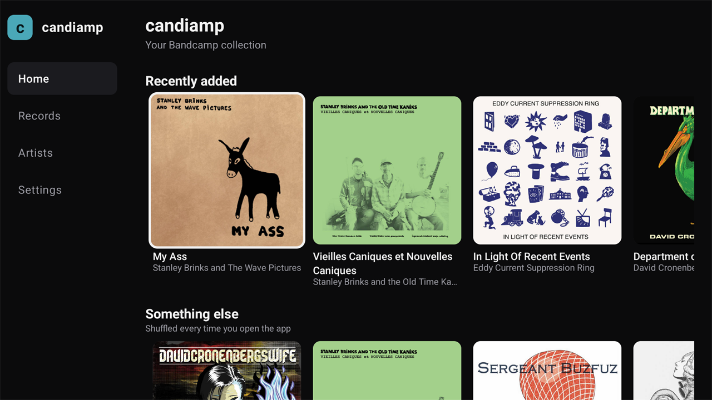
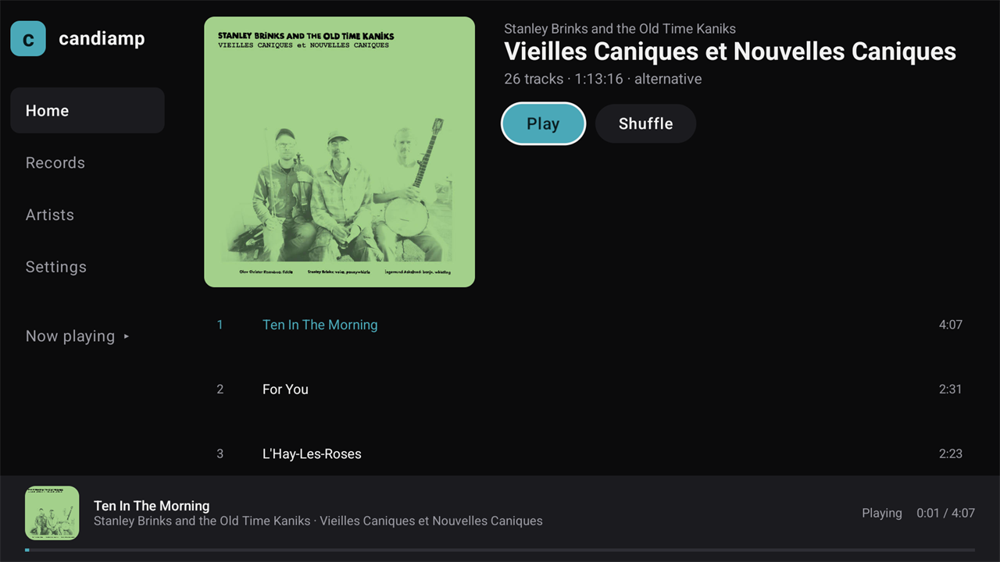
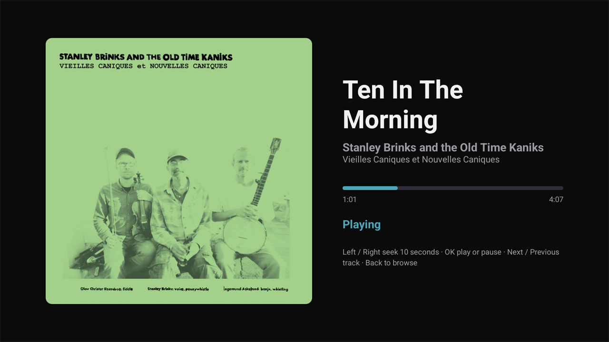
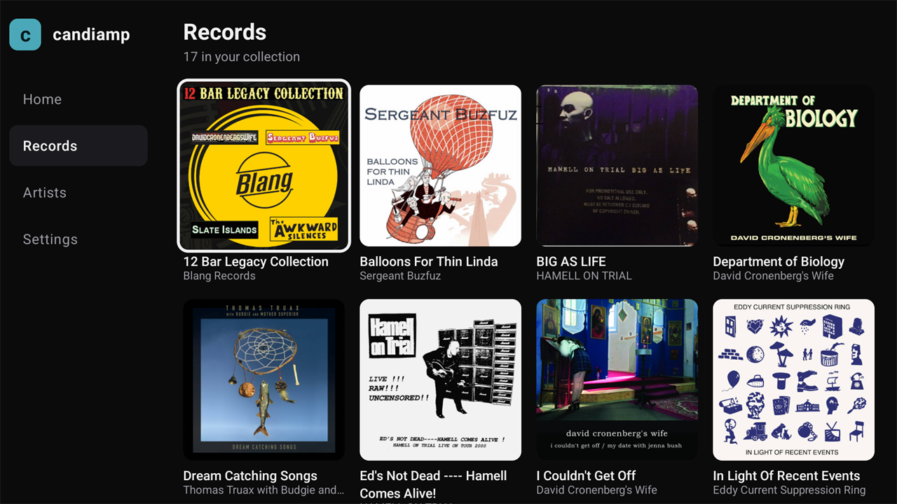
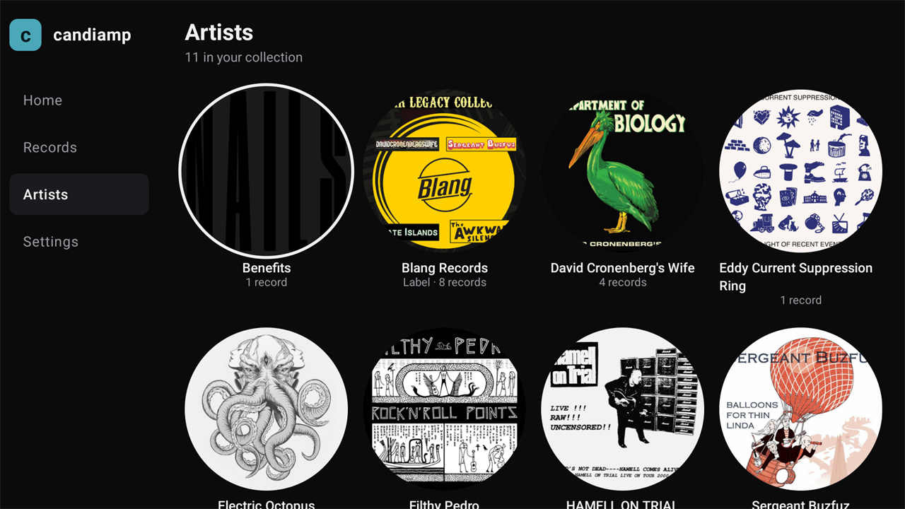
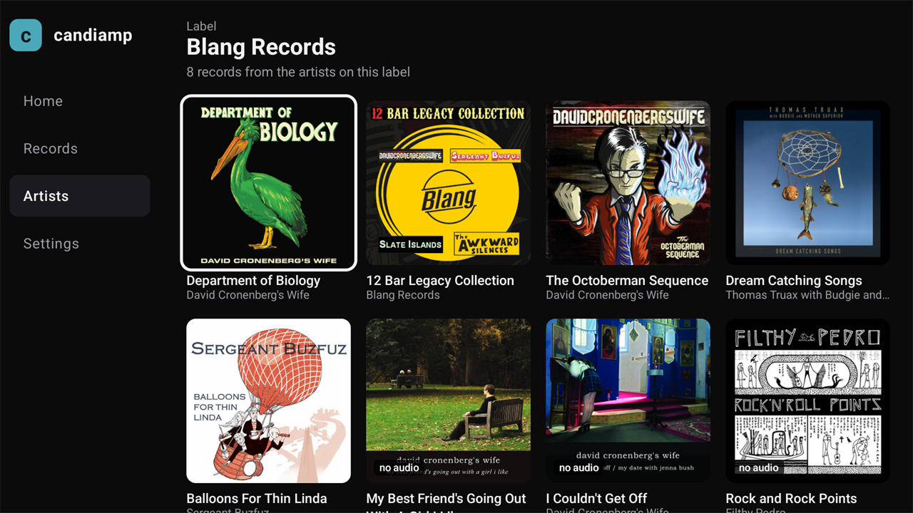
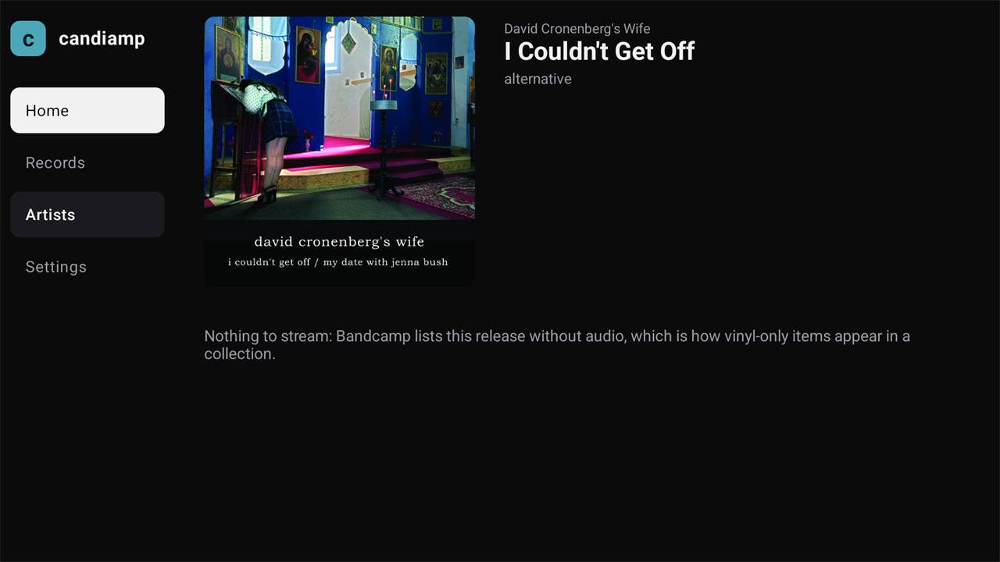
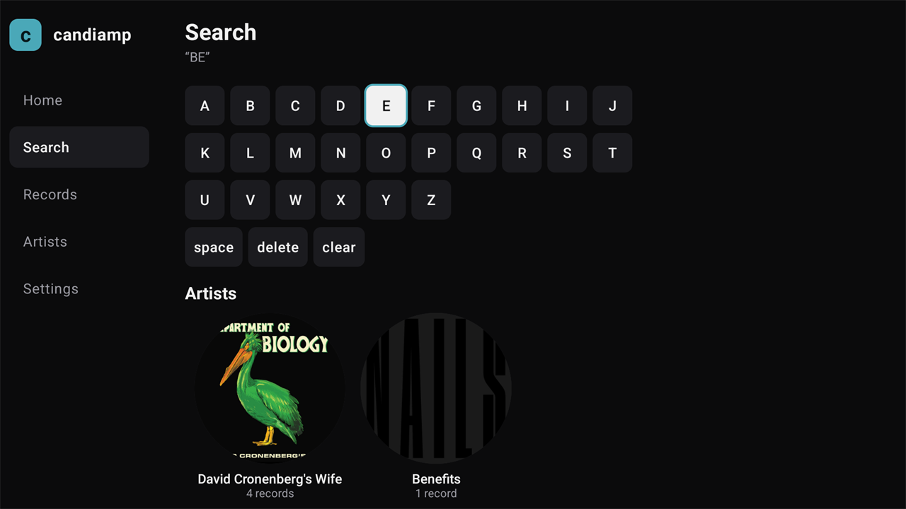
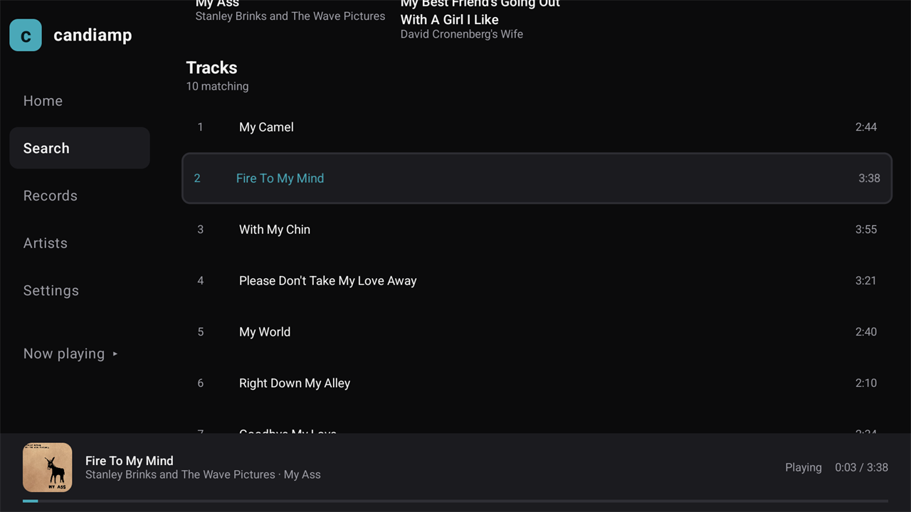

# candiamp.tv

Your Bandcamp collection, on the TV. An unofficial Android TV client for the **Subsonic endpoint Bandcamp shipped in July 2026** — no scraper, no server in the middle, no account.



## Status

Working, on a TCL Google TV (Android 14, `G08_4K_GB`), sideloaded. Built as a private app first; nothing here is published.

| Works | Notes |
|---|---|
| Browse collection | Artists → records → tracks, cached on disk |
| Search | `search3` over your own collection, with an on-screen keyboard, artist/album details on track results, and playback from results |
| Recently added / shuffled rows | From the album list, newest first |
| Play | 256 kbps VBR MP3, **seeking works** (server answers `206 Partial Content`) |
| TV remote | OK / play-pause / next / previous / 10-second seek |
| Background audio | Keeps playing when you leave the app (`MediaSession`) |
| Pairing from a phone | Local HTTP page served by the TV itself |
| Radio | Scraped from `bandcamp.com/radio`; whole episode as one stream, timestamped tracklist |
| Sync | ~4 s for 17 records / 190 tracks, library cached as JSON with a schema version |

| Missing, and why |
|---|
| Playlists — Bandcamp's API exposes `getPlaylists` but **not** `getPlaylist`, so a playlist's tracks cannot be read |
| Favourites / like — `star` accepts requests and does nothing, `unstar` is absent |
| Offline downloads — `download` returns an error; the API has no download role |
| Quality choice — `maxBitRate` is ignored, one encode only |
| Lyrics, similar artists, song info — not implemented by Bandcamp |

## Install

Needs JDK 21+ and the Android SDK (platform 37). On a TV with network debugging on:

```sh
adb connect <tv-ip>:5555
./gradlew assembleDebug
adb install -r app/build/outputs/apk/debug/app-debug.apk
```

## First run

The TV has no keyboard worth using, so the TV serves a small page on your own network:

1. **candiamp** shows `http://<tv-ip>:8080` and a four-character code.
2. Open that address on your phone, on the same Wi-Fi.
3. Paste the Subsonic credentials from `bandcamp.com → Settings → Fan → Subsonic`, type the code, press Connect.

Nothing leaves the LAN: the TV receives the form, stores the password in the Android keystore, and talks to `bandcamp.com` directly from then on.

No Wi-Fi on the TV? Push a file instead:

```sh
adb push candiamp.txt /sdcard/Download/candiamp.txt   # three lines: server, username, password
```

then choose **Import a file instead** on the pairing screen.

The pairing code is also written to logcat for development:

```sh
adb logcat -s candiamp
```

## Screens

| | |
|---|---|
|  |  |
|  |  |
|  |  |
|  |  |

Layout is built for a 960×540 dp canvas: the sidebar is 168 dp, records use `GridCells.Adaptive`, and rows carry focus-ring padding — a fixed four-across row silently squashed its last card on a 1080p TV.

## Why a native app

Bandcamp's Subsonic endpoint sends **no CORS headers** — not on the response, and not on the preflight. Every browser-based client (Feishin in a tab, SonicLair's PWA, and a Capacitor webview on the TV itself) fails at login because Chromium refuses to read the response. A native client sends no `Origin` header and is not subject to the policy. That is the whole reason this exists as Kotlin rather than a wrapper.

A WebView around bandcamp.com is the other road, and it is a dead end on a TV: no tvOS browser at all, no Roku browser, no focus order for a D-pad, and no media session.

## Radio — scraped, because the API has none

There is no radio in the API: `getInternetRadioStations` exists but returns an empty station list, so Bandcamp Radio is not exposed the way the collection is. The website is scrapeable though, and its shape is friendly:

- `/radio` carries `data-blob` JSON with `appData.shows[]`: `itemUrl`, `title`, `franchiseName`, `date`, `description`, `imageId`. Cover art is `https://f4.bcbits.com/img/<imageId>_170.jpg`.
- Each `/radio/<franchise>/<episode>` page carries `appData.show` with `compiledTrack { streamUrl, duration }` — the whole episode as one signed MP3 (≈90 min) — plus `tracks[]` where each entry has `album { title }`, `title`, `artistName`, `duration`, `timecode`, and `tracksSummary { totalCount, totalDuration }`.

What the app does with it:

- **Radio** in the sidebar lists the current episodes. The index does not carry episode durations; a duration appears once that episode has been opened and cached.
- Opening an episode plays the compiled stream through the same `Playback`/`MediaSession` path as everything else: one media item, remote play/pause and 10-second seek work, and audio keeps going when you leave the app.
- The episode page shows the timestamped tracklist. The current track is highlighted from `Playback.positionMs`, with a "You're hearing …" line. Selecting any track starts the episode at its timecode (or seeks, if it is already playing).
- The index and each parsed episode are cached on disk. A changed page shape produces a readable error on the Radio screen and never affects collection playback. **Signed URLs are never written to the cache** — they carry `ts`/`t` — so they are re-resolved at play time and kept in memory for ten minutes.
- Radio audio is `mp3-128`; owned collection streams are `mp3-v0` (~256 kbps).

This is a scraper, not an API: the HTML can change without notice. `data/BandcampRadio.kt` holds both the fetch and the parse, `data/RadioLibrary.kt` holds the cache and the URL policy, and `BandcampRadioTest` pins the field names measured in November 2026.

## API notes (measured, 2026-11)

Four different failure shapes, all of which the client normalises:

| Situation | Response |
|---|---|
| Wrong credentials | HTTP **500**, empty body |
| Endpoint that does not exist | HTTP **200**, `{"error":true,"error_message":"bad version"}` |
| Stub endpoint | HTTP 200, Subsonic envelope with an empty payload |
| Bad song id on `stream` | HTTP 200, XML |

And four rules learned the hard way:

1. **Calls live under `/rest/`.** The published server URL is `https://bandcamp.com/api/subsonic`, but every request is `…/api/subsonic/rest/<endpoint>.view`. Without `/rest` the router answers `"bad version"`, which reads like a version problem and is not one.
2. **`ping` never validates credentials** — it says `ok` for anything. A "test connection" must call `getArtists` or `getAlbumList2`.
3. **Dedupe by album id, and take names from `getArtists`.** One album appears under both the label ("Blang Records") and the actual artist, and a label's own `artist.name` from `getArtist` is whatever its first album's artist is called — reading it renamed Blang Records to "David Cronenberg's Wife".
4. **Artist artwork has to come from a record.** `getArtists` hands out the same `ci:` cover id to several artists at once (Blang's logo arrived for five of them), so the app uses the cover of a record credited to that artist.

Other quirks: no `discNumber` (long albums flatten to `track` 1..N), no `year` on albums (`created` only), `type=starred` returns the entire collection, and `getCoverArt` serves one fixed ~16 KB JPEG and ignores `size`.

**Zero-track records are vinyl-only.** Three of the seventeen have `songCount: 0`: Bandcamp sells them but has no audio to stream, exactly as the website shows them. The app lists them (counting only playable records would make it disagree with the site), marks the card **no audio**, and hides Play on the record page.

**Single tracks collected on their own are listed but unreachable.** Fourth case: `a:2067464040` "Under A Black Moon" appears in `getAlbumList2` with `songCount: 1`, yet `getAlbum` answers `{"status":"failed","error":{"code":70,"message":"not found"}}`, `getSong` knows neither `t:` nor `a:` with that number, `search3` finds nothing and `stream` returns XML. The website plays it from the release page; the API cannot. Sync therefore probes every one-track entry once and flags it the same way, so the card carries **no audio** before you open it and the record page explains which case it is.

**Labels sit in the same list as artists.** `getArtists` returns Blang Records alongside its own artists and offers no flag to tell them apart. The app infers it: a page whose records are credited to two or more different artists is a label, so it gets a **Label** crumb and says "8 records from the artists on this label" — which is more legible than Bandcamp's own page, where the releases are simply mixed together.

## Code map

```
data/SubsonicClient.kt   auth, the four error shapes, endpoint parsing
data/MusicLibrary.kt     sync (artists + album cards), track lists on demand, JSON cache
data/BandcampRadio.kt    the radio scraper: index + data-blob episode parsing
data/RadioLibrary.kt     radio index/episode cache; signed stream URLs stay in memory
data/Credentials.kt      server/user in prefs, password sealed with the Android keystore
playback/Playback.kt     one ExoPlayer + MediaSession for the app, stream URLs resolved at play time
pairing/PairingServer.kt a ~200-line local HTTP server serving the setup form
ui/                      Compose for TV: sidebar, rows, record page, radio, player, settings
```

`MusicSource` seam: everything the UI needs for the collection is `MusicLibrary`. Radio deliberately sits beside it as its own `RadioLibrary`, because it is scraped and must be able to fail without touching collection playback. A future web build would need a proxy, not a rewrite.

## Not affiliated with Bandcamp
